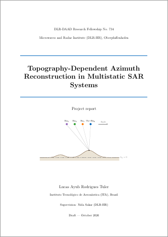
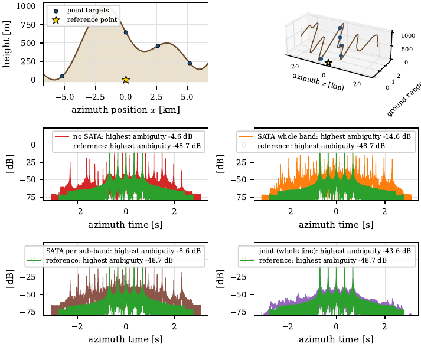

# dlr-project — topography-dependent azimuth reconstruction in multichannel SAR

Numerical study of **multichannel / multistatic SAR azimuth reconstruction over topography** (HRWS systems), developed
at the DLR Microwaves and Radar Institute (DLR-HR) within a DLR-DAAD fellowship.

## 📄 Project report — [read the PDF](report/report.pdf)

<table>
<tr>
<td width="32%"><a href="report/report.pdf"></a></td>
<td>
<b><a href="report/report.pdf">Topography-Dependent Azimuth Reconstruction in Multistatic SAR Systems</a></b> (draft)<br><br>
Signal model and the coefficients C<sub>0</sub>, C<sub>1</sub>, C<sub>2</sub>; multichannel reconstruction and how topography
creates ambiguities; SATA and why it fails on aliased channels; the joint reconstruction (final method) in 1-D and 2-D;
sweeps over terrains, numbers of channels and baselines.<br><br>
<a href="report/report.pdf">PDF</a> · <a href="report/">LaTeX sources</a>
</td>
</tr>
</table>

<p align="center">
<a href="report/report.pdf"></a><br>
<sub>Five targets on random mountains, four channels: no SATA, SATA whole band, SATA per sub-band and the joint
reconstruction (bottom right), all with the DEM only.</sub>
</p>

A multichannel SAR samples the azimuth signal at a PRF below the Doppler bandwidth and recovers it by combining the
channels. The reconstruction filters assume a reference geometry (flat earth); when the scene has topography and the
channels have cross-track baselines, every scatterer carries a channel-dependent phase residual
(&Delta;C<sub>0</sub>) and the folded parts of the spectrum no longer cancel, leaving azimuth ambiguities.

**Questions addressed**

1. How large are the ambiguities caused by unaccounted topography, as a function of terrain, baselines and number of channels?
2. How much of them can be corrected using **only the system parameters and a DEM** (no knowledge of where the targets are)?

## Methods compared

| Method | Description | Code |
| --- | --- | --- |
| Reference | monostatic signal of the scene, no ambiguities | `sata1d.generate_reference` |
| No SATA | standard reconstruction with the flat-earth filters | `sata1d.reconstruct` |
| SATA, whole band | per-channel topography correction in sub-apertures, then reconstruction | `sata1d.sata_channels` |
| SATA, per sub-band | the same, with one correction per output sub-band | `sata1d.reconstruct_subband` |
| Joint (sub-apertures) | correction inside the inversion: the &Delta;C<sub>0</sub> of every folded parcel enters the matrix | `sata1d.reconstruct_joint` |
| **Joint (whole line)** | final version: the channels are modelled from the focused line and the DEM and solved by regularised least squares (CGLS) | `sata1d.reconstruct_joint_line` |
| Joint 2-D | the whole-line joint for 3-D scenes (azimuth × range) | `sata2d/joint2d.py` |
| Oracle | targets simulated already corrected (lower bound, not realisable) | — |

## Repository layout

```
dlr-project/
├── sata1d_code/                1-D study (azimuth only) — main code
│   ├── sata1d/                 package: config, geometry, signal model, reconstruction,
│   │                           SATA (whole band, per sub-band), joint, joint_line
│   ├── joint_cases/            joint reconstruction: case runs, sweeps, audits with a DEM only, guides
│   ├── joint_standalone/       self-contained copy of the whole-line joint (package joint1d)
│   ├── legacy/                 previous per-sub-band fit (used by the verification scripts)
│   └── *.py                    single runs, sweeps, figures and verification (T1–T19)
│
├── sar_reconstruction/
│   ├── sata2d/                 2-D study: 3-D geometry, SATA 2-D, joint 2-D, sweeps
│   ├── sar_recon/              original reconstruction package (first phase of the project)
│   └── CUSTOMIZATION_GUIDE.md
│
├── runs/                       experiments of the first phase (sar_recon)
│   ├── core/                   reconstruction, coefficient and sub-band experiments
│   ├── validation/             validation against the analytic model
│   └── sata/                   reference SATA code (IDL) and its Python port
│
├── report/                     project report (LaTeX + TikZ, compiled PDF)
├── results/                    scripts that assemble the result PDFs
├── pyproject.toml
└── requirements.txt
```

Detailed documentation: [`sata1d_code/README.md`](sata1d_code/README.md) (SATA and joint in 1-D),
[`sata1d_code/joint_standalone/README.md`](sata1d_code/joint_standalone/README.md) (minimal joint),
[`sar_reconstruction/sata2d/README.md`](sar_reconstruction/sata2d/README.md) (2-D study),
[`sar_reconstruction/CUSTOMIZATION_GUIDE.md`](sar_reconstruction/CUSTOMIZATION_GUIDE.md) (`sar_recon`).

## Setup

Python 3.10+.

```bash
git clone https://github.com/lucas-ayub/dlr-project.git
cd dlr-project
pip install -r requirements.txt scipy
pip install -e .        # installs sar_recon and sata2d (sources in sar_reconstruction/)
```

The 1-D package `sata1d` is not installed: run its scripts from `sata1d_code/`.

## Quick start

**1-D — one scene, every method** (from `sata1d_code/`):

```bash
python run_one_case.py --scene dense_ramp --mode none whole sub joint oracle
python run_one_case.py --targets 0:500 --mode none joint      # custom targets x:h [m]
```

**1-D — final joint reconstruction, minimal example** (from `sata1d_code/joint_standalone/`):

```bash
python run_example.py         # 5 targets on a 1000 m mountain; prints the ambiguity levels, saves joint_example.png
```

```python
import numpy as np
import sata1d as S

terrain  = lambda x: 1000.0 * np.exp(-x**2 / (2 * 1500.0**2))   # DEM h(x) [m]
points   = [(x, terrain(x)) for x in (-2000.0, 0.0, 2000.0)]     # targets (x, h) [m]
cfg      = S.make_config(points, bxt_max=100.0, tx_rx_channel0=True)
tracks   = S.build_platform_tracks(cfg)
channels = S.generate_channels(cfg, tracks)                      # simulated channel data
dC0      = S.line_maps(cfg, tracks, terrain)                     # from the DEM only
image    = S.reconstruct_joint_line(cfg, tracks, channels, dC0)  # line at the full PRF
```

**1-D — sweeps and checks** (from `sata1d_code/`):

```bash
python verify_sata1d.py                                   # verification tests T1–T19 (~15 min)
python joint_cases/audit_checks.py --part kernel base     # audit of the joint with a DEM only (PASS / FAIL)
python joint_cases/sweep_joint_all.py --workers 4         # complete sweep of the final joint (resumable)
```

**2-D** (from `sar_reconstruction/`):

```bash
python -m sata2d.run_sata2d_topo --plots                  # main 3-D geometry experiment
python -m sata2d.run_sweep_joint2d_all --workers 3        # complete sweep of the 2-D joint (resumable)
```

## Outputs

Figures, PDFs and numbers are written by the scripts to `plots/` folders or next to them (`results/`,
`joint_cases/...`). They are not versioned (see `.gitignore`).

## Author

Lucas Ayub Rodrigues Tuler — ITA (Instituto Tecnológico de Aeronáutica) / DLR Microwaves and Radar Institute,
Oberpfaffenhofen.
