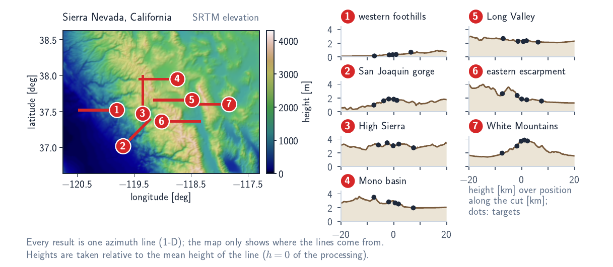

# dlr-project — topography-dependent azimuth reconstruction in multichannel SAR

Numerical study of **multichannel / multistatic SAR azimuth reconstruction over topography** (HRWS systems), developed
at the DLR Microwaves and Radar Institute (DLR-HR) within a DLR-DAAD fellowship.

## 📄 Project report — [read the PDF](report/report.pdf)

<table>
<tr>
<td width="32%"><a href="report/report.pdf"></a></td>
<td>
<b><a href="report/report.pdf">Topography-Dependent Azimuth Reconstruction in Multistatic SAR Systems</a></b><br>DLR-DAAD fellowship report, November 2026<br><br>
Signal model and C<sub>0</sub>, C<sub>1</sub>, C<sub>2</sub>; how topography creates ambiguities; the joint reconstruction
(model, matrix-free solver, regularisation); results on simulated and SRTM terrain and their limits.<br><br>
<a href="report/report.pdf">PDF</a> · <a href="report/">LaTeX sources</a>
</td>
</tr>
</table>

<p align="center">
<a href="report/report.pdf"></a><br>
<sub>Five targets on a 1000 m mountain: standard reconstruction &minus;4.4 dB, joint reconstruction (DEM only)
&minus;40.8 dB, reference &minus;41.4 dB; right: against the mountain height.</sub><br><br>
<a href="report/report.pdf"></a><br>
<sub>47 km lines from the SRTM 3'' DEM of the Sierra Nevada: the joint reconstruction is within 3 dB of the reference on six
of seven cuts (150 random lines: see the table below).</sub>
</p>

<p align="center"><b>🎬 How the joint reconstruction works</b> (animation, 4 min)</p>

<!-- The video is a GitHub upload: a video committed to the repository does not play in a README.
     To set or replace it: edit this file on github.com, drag the .mp4 (H.264, under 10 MB) onto the empty line
     below this comment, wait until GitHub writes its https://github.com/user-attachments/assets/... link, and commit. -->

https://github.com/user-attachments/assets/6e90b157-4b01-40fe-99bc-f6733f9ec6a3


<p align="center"><sub>From the aliased channels to the focused line: geometry, channel filters, the model as matrices, the
regularised solver and the comparison with the reference (simulation: four channels, three targets on a 250 m hill).</sub></p>

A multichannel SAR samples each channel below the Doppler bandwidth and combines the channels with filters that assume a
flat earth. With topography and cross-track baselines every scatterer carries a channel-dependent phase
(&Delta;C<sub>0</sub>), the folded spectrum no longer cancels, and azimuth ambiguities appear.

**Questions addressed**

1. How large are the ambiguities caused by topography, on simulated and real terrain?
2. How much can be corrected with **only the system parameters and a DEM** (target positions unknown)?
3. Where does the correction stop working (blind heights, DEM accuracy, cliffs, moving baselines, noise, regularisation)?

**Main results** (default formation: four channels, cross-track baselines 300 m, 119.8 m and 100.5 m; details in the [report](report/report.pdf))

| | Standard reconstruction | Joint reconstruction | Reference |
| --- | --- | --- | --- |
| 1000 m mountain, five targets: highest ambiguity | &minus;4.4 dB | &minus;40.8 dB | &minus;41.4 dB |
| Nine simulated terrains (median) | &minus;7.2 dB | &minus;38.3 dB | &minus;38.8 dB |
| 150 random SRTM lines, Sierra Nevada (median) | &minus;6.2 dB | &minus;39.8 dB | &minus;40.7 dB |

- **Mountain height 0 to 3 km:** within 3 dB of the reference at 22 of 31 heights, hurt only near blind heights, same
  resolution as the reference (3 dB width 5.77 m).
- **1 to 200 targets per line:** image error about &minus;30 dB (the model accuracy) at every density.
- **Two close targets beside a cliff up to 1000 m:** &minus;59 dB to &minus;43 dB; only a target on the cliff face (more
  than about 100 m of height change between two DEM samples) degrades it.
- **Limits:** blind heights (a place and its alias with the same phase in every receiver); DEM accuracy (about 2 m rms for
  &minus;30 dB with a 300 m baseline); a time-varying baseline leaves
  &phi;<sub>&epsilon;</sub> &asymp; (2&pi;/&lambda;)&middot;&epsilon;(t)&middot;h/(r<sub>0</sub> tan&theta;), so &epsilon; must stay below
  about 0.2 m (spaceborne, 1000 m of relief) or millimetres to centimetres (airborne).
- **Regularisation:** without noise &mu; = 0.03&nbsp;&sigma;<sub>max</sub> beats the tested parameter-choice rules (L-curve,
  discrepancy, Bayes minimum risk); with noise MARIA gains up to 15 dB on point-target scenes.

## Methods compared

| Method | Description | Code |
| --- | --- | --- |
| Reference | monostatic signal of the scene, no ambiguities | `sata1d.generate_reference` |
| Standard reconstruction | multichannel reconstruction with the flat-earth filters | `sata1d.reconstruct` |
| **Joint reconstruction** | the method of the report: the channels are modelled from the focused line and the DEM and solved by regularised least squares (conjugate gradients), without forming the matrix | `sata1d.reconstruct_joint_line` |

Earlier and exploratory code, not used in the report, is kept in the repository: a per-channel correction before the
reconstruction (`sata1d.sata_channels`, `sata1d.reconstruct_subband`), a first version of the joint reconstruction in
sub-apertures (`sata1d.reconstruct_joint`), an oracle with the targets simulated already corrected, and a 2-D extension
(`sar_reconstruction/sata2d`).

## Repository layout

```
dlr-project/
├── sata1d_code/                1-D study (azimuth only) — main code
│   ├── sata1d/                 package: config, geometry, signal model, reconstruction,
│   │                           per-channel correction (earlier approach), joint, joint_line
│   ├── joint_cases/            joint reconstruction: case runs, sweeps, audits, real terrain (real_dem/)
│   ├── joint_standalone/       self-contained copy of the whole-line joint (package joint1d)
│   ├── legacy/                 previous per-sub-band fit (used by the verification scripts)
│   └── *.py                    single runs, sweeps, figures and verification (T1–T19)
│
├── sar_reconstruction/
│   ├── sata2d/                 exploratory 2-D study: 3-D geometry, joint 2-D, sweeps
│   ├── sar_recon/              original reconstruction package (first phase of the project)
│   └── CUSTOMIZATION_GUIDE.md
│
├── runs/                       experiments: first phase (sar_recon) and the analyses of the final report
│   ├── core/                   reconstruction, coefficient and sub-band experiments
│   ├── validation/             validation against the analytic model
│   ├── sata/                   reference code of the per-channel correction (IDL) and its Python port
│   └── analysis_v30/           analyses of the final report (height, dense scenes, close targets by a cliff, baselines, solvers)
│
├── report/                     project report (LaTeX + TikZ, compiled PDF)
├── results/                    scripts that assemble the result PDFs
├── pyproject.toml
└── requirements.txt
```

Detailed documentation: [`sata1d_code/README.md`](sata1d_code/README.md) (1-D package and the joint reconstruction),
[`sata1d_code/joint_standalone/README.md`](sata1d_code/joint_standalone/README.md) (minimal joint),
[`sar_reconstruction/sata2d/README.md`](sar_reconstruction/sata2d/README.md) (2-D study),
[`sar_reconstruction/CUSTOMIZATION_GUIDE.md`](sar_reconstruction/CUSTOMIZATION_GUIDE.md) (`sar_recon`).

## Setup

Python 3.10+.

```bash
git clone https://github.com/lucas-ayub/dlr-project.git
cd dlr-project
pip install -r requirements.txt scipy
pip install -e .        # installs sar_recon and sata2d (sources in sar_reconstruction/)
```

The 1-D package `sata1d` is not installed: run its scripts from `sata1d_code/`.

## Quick start

**1-D — one scene, every method** (from `sata1d_code/`):

```bash
python run_one_case.py --scene dense_ramp --mode none joint oracle
python run_one_case.py --targets 0:500 --mode none joint      # custom targets x:h [m]
```

**1-D — final joint reconstruction, minimal example** (from `sata1d_code/joint_standalone/`):

```bash
python run_example.py         # 5 targets on a 1000 m mountain; prints the ambiguity levels, saves joint_example.png
```

```python
import numpy as np
import sata1d as S

terrain  = lambda x: 1000.0 * np.exp(-x**2 / (2 * 1500.0**2))   # DEM h(x) [m]
points   = [(x, terrain(x)) for x in (-2000.0, 0.0, 2000.0)]     # targets (x, h) [m]
cfg      = S.make_config(points, bxt_max=100.0, tx_rx_channel0=True)
tracks   = S.build_platform_tracks(cfg)
channels = S.generate_channels(cfg, tracks)                      # simulated channel data
dC0      = S.line_maps(cfg, tracks, terrain)                     # from the DEM only
image    = S.reconstruct_joint_line(cfg, tracks, channels, dC0)  # line at the full PRF
```

**1-D — earlier sweeps and checks** (from `sata1d_code/`):

```bash
python verify_sata1d.py                                   # verification tests T1–T19 (~15 min)
python joint_cases/audit_checks.py --part kernel base     # audit of the joint with a DEM only (PASS / FAIL)
python joint_cases/sweep_joint_all.py --workers 4         # complete sweep of the final joint (resumable)
```

**2-D, exploratory, not in the report** (from `sar_reconstruction/`):

```bash
python -m sata2d.run_sata2d_topo --plots                  # main 3-D geometry experiment
python -m sata2d.run_sweep_joint2d_all --workers 3        # complete sweep of the 2-D joint (resumable)
```

**1-D — analyses of the final report** (from `runs/analysis_v30/`, see the README of each folder):

```bash
cd runs/analysis_v30/joint_height_dense
python3 -I item1_height.py && python3 -I plot_item1.py    # ambiguity and resolution vs mountain height (~1 min)
DEM_DIR=/path/to/dem python3 -I item3_dense.py && python3 -I plot_item3.py   # scenes full of point targets (~5 min)
cd ../baselines_solvers
python3 -I item2_baseline_variation.py && python3 -I item2_joint.py           # baselines that vary in time (~5 min)
python3 -I verify_phi_eps.py                                                  # check of the phi_eps law against exact distances
python3 -I verify_dC0.py                                                      # check of the Delta C0 formula against the exact fits
DEM_DIR=/path/to/dem python3 -I item5_regularisation.py && python3 -I plot_item5.py   # other solvers (~12 min)
cd ../close_targets_height_step
python3 -I item_close.py && python3 -I plot_close.py           # close targets next to a cliff or a bump (~3 min)
```

**1-D — further real-terrain runs, not in the report** (from `sata1d_code/joint_cases/real_dem/`, see its README):
`run_real_dem.py` then `real_dem_figures.py` (five named SRTM lines and 200 random lines with fixed target positions).

The scripts find the repository root by walking up to `sata1d_code/` (or from `DLR_REPO`). The SRTM lines need the
GeoTIFF `main_srtm90.tif` in `DEM_DIR` (default `data/dem/`, not versioned). Each folder has a `results.md` with every
number of the report and the script that produces it.

## Outputs

Figures, PDFs and numbers are written by the scripts to `plots/` folders or next to them (`results/`,
`joint_cases/...`). They are not versioned (see `.gitignore`).

## Author

Lucas Ayub Rodrigues Tuler — ITA (Instituto Tecnológico de Aeronáutica) / DLR Microwaves and Radar Institute,
Oberpfaffenhofen.
