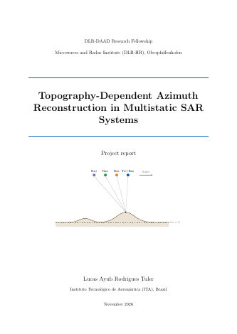
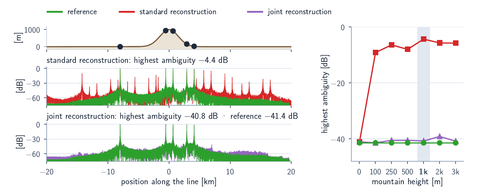
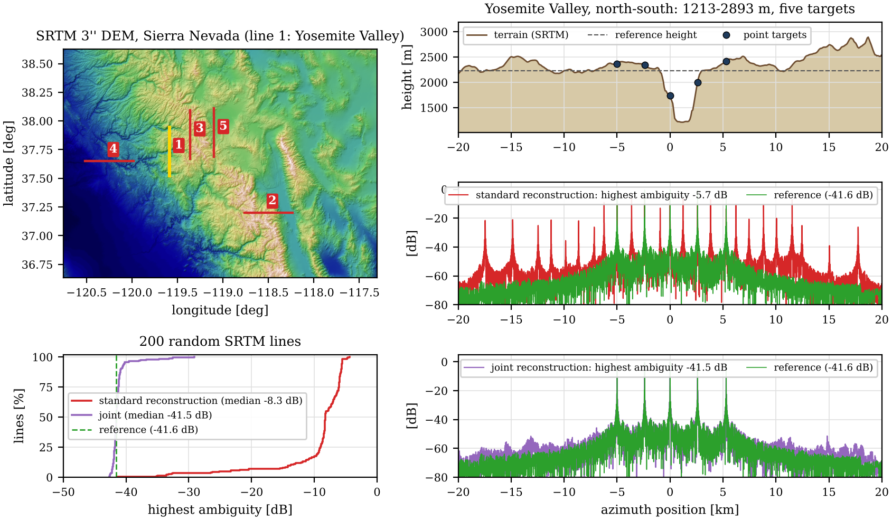

# dlr-project — topography-dependent azimuth reconstruction in multichannel SAR

Numerical study of **multichannel / multistatic SAR azimuth reconstruction over topography** (HRWS systems), developed
at the DLR Microwaves and Radar Institute (DLR-HR) within a DLR-DAAD fellowship.

## 📄 Project report — [read the PDF](report/report.pdf)

<table>
<tr>
<td width="32%"><a href="report/report.pdf"></a></td>
<td>
<b><a href="report/report.pdf">Topography-Dependent Azimuth Reconstruction in Multistatic SAR Systems</a></b><br>DLR-DAAD fellowship report, November 2026<br><br>
Signal model and the coefficients C<sub>0</sub>, C<sub>1</sub>, C<sub>2</sub>; multichannel reconstruction and how topography
creates ambiguities; the joint reconstruction (final method) along one azimuth line: the model, the matrix-free solver and
its regularisation; results on simulated and real (SRTM) terrain, ambiguity and resolution against the mountain height,
scenes full of targets, blind heights, DEM accuracy, baselines that vary during the aperture and other regularisation
methods.<br><br>
<a href="report/report.pdf">PDF</a> · <a href="report/">LaTeX sources</a>
</td>
</tr>
</table>

<p align="center">
<a href="report/report.pdf"></a><br>
<sub>Five targets on a 1000 m Gaussian mountain, four channels: the standard reconstruction leaves ambiguities up to
&minus;4.4 dB, the joint reconstruction (DEM only) reaches &minus;40.8 dB against &minus;41.4 dB for the reference; right: the
same against the height of the mountain.</sub><br><br>
<a href="report/report.pdf"></a><br>
<sub>Real terrain: 47 km azimuth lines cut from the SRTM 3'' DEM of the Sierra Nevada. Yosemite Valley (line 1, five
targets, four channels): highest ambiguity &minus;5.7 dB with the standard reconstruction and &minus;41.5 dB with the joint
reconstruction, at the level of the reference (&minus;41.6 dB); over 200 random lines (fixed target positions) the median goes
from &minus;8.3 dB to &minus;41.5 dB, with the geometry and the DEM only. Code: <a href="sata1d_code/joint_cases/real_dem/">sata1d_code/joint_cases/real_dem</a>.</sub>
</p>

<p align="center"><b>🎬 How the joint reconstruction works</b> (animation, 4 min)</p>

<!-- The video is a GitHub upload: a video committed to the repository does not play in a README.
     To set or replace it: edit this file on github.com, drag the .mp4 (H.264, under 10 MB) onto the empty line
     below this comment, wait until GitHub writes its https://github.com/user-attachments/assets/... link, and commit. -->

https://github.com/user-attachments/assets/6e90b157-4b01-40fe-99bc-f6733f9ec6a3


<p align="center"><sub>From the aliased channels to the focused line: the acquisition, the range histories and the
channel filter H<sub>i</sub> inside K<sub>i</sub>, the model as matrices, why it cannot be solved Doppler bin by Doppler
bin, the back-projection of all receivers, the iterations of the regularised solver and the comparison with the reference IRF. Every curve
comes from the simulation (four channels, three targets on a 250 m hill).</sub></p>

A multichannel SAR samples the azimuth signal at a PRF below the Doppler bandwidth and recovers it by combining the
channels. The reconstruction filters assume a reference geometry (flat earth); when the scene has topography and the
channels have cross-track baselines, every scatterer carries a channel-dependent phase residual
(&Delta;C<sub>0</sub>) and the folded parts of the spectrum no longer cancel, leaving azimuth ambiguities.

**Questions addressed**

1. How large are the ambiguities caused by unaccounted topography, on simulated and real terrain?
2. How much of them can be corrected using **only the system parameters and a DEM** (no knowledge of where the targets are)?
3. Where does that correction stop working: blind heights, DEM accuracy, abrupt height changes, baselines that vary
   during the aperture, noise and the choice of regularisation?

**Main results** (default formation: four channels, cross-track baselines 300 m, 119.8 m and 100.5 m; details in the [report](report/report.pdf))

| | Standard reconstruction | Joint reconstruction | Reference |
| --- | --- | --- | --- |
| 1000 m mountain, five targets: highest ambiguity | &minus;4.4 dB | &minus;40.8 dB | &minus;41.4 dB |
| Nine simulated terrains (median) | &minus;7.2 dB | &minus;38.3 dB | &minus;38.8 dB |
| 150 random SRTM lines, Sierra Nevada (median) | &minus;6.2 dB | &minus;39.8 dB | &minus;40.7 dB |

- **Mountain height 0 to 3 km:** the joint reconstruction is within 3 dB of the reference at 22 of 31 heights, is clearly
  hurt only near blind heights, and keeps the resolution of the reference (3 dB width 5.77 m).
- **Lines full of targets (1 to 200):** image error of the joint reconstruction about &minus;30 dB, the accuracy of the
  model, independent of the number of targets; the few failures are near blind heights.
- **Two close targets beside a cliff up to 1000 m:** &minus;59 dB to &minus;43 dB; it degrades only for a target on the
  cliff face, where the height changes by more than about 100 m between two DEM samples.
- **Limits:** blind heights (a place and its alias get the same phase in every receiver); DEM accuracy (about 2 m rms
  for &minus;30 dB with a 300 m baseline); a cross-track baseline that varies during the aperture leaves a phase
  &phi;<sub>&epsilon;</sub> &asymp; (2&pi;/&lambda;)&middot;&epsilon;(t)&middot;h/(r<sub>0</sub> tan&theta;), so &epsilon; must stay below
  about 0.2 m (spaceborne, 1000 m of relief) or millimetres to centimetres (airborne).
- **Regularisation:** without noise the current choice &mu; = 0.03&nbsp;&sigma;<sub>max</sub> is the best of the
  parameter-choice rules tested (L-curve, discrepancy, Bayes minimum risk); with noise the re-weighting method MARIA gains
  up to 15 dB on scenes of point targets.

## Methods compared

| Method | Description | Code |
| --- | --- | --- |
| Reference | monostatic signal of the scene, no ambiguities | `sata1d.generate_reference` |
| Standard reconstruction | multichannel reconstruction with the flat-earth filters | `sata1d.reconstruct` |
| **Joint (whole line)** | final method, used in the report: the channels are modelled from the focused line and the DEM and solved by regularised least squares (conjugate gradients) | `sata1d.reconstruct_joint_line` |
| Per-channel correction (whole band / per sub-band) | earlier approach, not used in the report: topography correction of each channel in sub-apertures before the reconstruction | `sata1d.sata_channels`, `sata1d.reconstruct_subband` |
| Joint (sub-apertures) | earlier version of the joint: the &Delta;C<sub>0</sub> of every folded parcel enters the matrix | `sata1d.reconstruct_joint` |
| Joint 2-D | exploratory extension to 3-D scenes (azimuth × range), not part of the report (future work) | `sata2d/joint2d.py` |
| Oracle | targets simulated already corrected (lower bound, not realisable) | — |

## Repository layout

```
dlr-project/
├── sata1d_code/                1-D study (azimuth only) — main code
│   ├── sata1d/                 package: config, geometry, signal model, reconstruction,
│   │                           per-channel correction (earlier approach), joint, joint_line
│   ├── joint_cases/            joint reconstruction: case runs, sweeps, audits, real terrain (real_dem/)
│   ├── joint_standalone/       self-contained copy of the whole-line joint (package joint1d)
│   ├── legacy/                 previous per-sub-band fit (used by the verification scripts)
│   └── *.py                    single runs, sweeps, figures and verification (T1–T19)
│
├── sar_reconstruction/
│   ├── sata2d/                 exploratory 2-D study: 3-D geometry, joint 2-D, sweeps
│   ├── sar_recon/              original reconstruction package (first phase of the project)
│   └── CUSTOMIZATION_GUIDE.md
│
├── runs/                       experiments: first phase (sar_recon) and the analyses of the final report
│   ├── core/                   reconstruction, coefficient and sub-band experiments
│   ├── validation/             validation against the analytic model
│   ├── sata/                   reference code of the per-channel correction (IDL) and its Python port
│   └── analysis_v30/           analyses of the final report (height, dense scenes, close targets by a cliff, baselines, solvers)
│
├── report/                     project report (LaTeX + TikZ, compiled PDF)
├── results/                    scripts that assemble the result PDFs
├── pyproject.toml
└── requirements.txt
```

Detailed documentation: [`sata1d_code/README.md`](sata1d_code/README.md) (1-D package and the joint reconstruction),
[`sata1d_code/joint_standalone/README.md`](sata1d_code/joint_standalone/README.md) (minimal joint),
[`sar_reconstruction/sata2d/README.md`](sar_reconstruction/sata2d/README.md) (2-D study),
[`sar_reconstruction/CUSTOMIZATION_GUIDE.md`](sar_reconstruction/CUSTOMIZATION_GUIDE.md) (`sar_recon`).

## Setup

Python 3.10+.

```bash
git clone https://github.com/lucas-ayub/dlr-project.git
cd dlr-project
pip install -r requirements.txt scipy
pip install -e .        # installs sar_recon and sata2d (sources in sar_reconstruction/)
```

The 1-D package `sata1d` is not installed: run its scripts from `sata1d_code/`.

## Quick start

**1-D — one scene, every method** (from `sata1d_code/`):

```bash
python run_one_case.py --scene dense_ramp --mode none joint oracle
python run_one_case.py --targets 0:500 --mode none joint      # custom targets x:h [m]
```

**1-D — final joint reconstruction, minimal example** (from `sata1d_code/joint_standalone/`):

```bash
python run_example.py         # 5 targets on a 1000 m mountain; prints the ambiguity levels, saves joint_example.png
```

```python
import numpy as np
import sata1d as S

terrain  = lambda x: 1000.0 * np.exp(-x**2 / (2 * 1500.0**2))   # DEM h(x) [m]
points   = [(x, terrain(x)) for x in (-2000.0, 0.0, 2000.0)]     # targets (x, h) [m]
cfg      = S.make_config(points, bxt_max=100.0, tx_rx_channel0=True)
tracks   = S.build_platform_tracks(cfg)
channels = S.generate_channels(cfg, tracks)                      # simulated channel data
dC0      = S.line_maps(cfg, tracks, terrain)                     # from the DEM only
image    = S.reconstruct_joint_line(cfg, tracks, channels, dC0)  # line at the full PRF
```

**1-D — earlier sweeps and checks** (from `sata1d_code/`):

```bash
python verify_sata1d.py                                   # verification tests T1–T19 (~15 min)
python joint_cases/audit_checks.py --part kernel base     # audit of the joint with a DEM only (PASS / FAIL)
python joint_cases/sweep_joint_all.py --workers 4         # complete sweep of the final joint (resumable)
```

**2-D, exploratory, not in the report** (from `sar_reconstruction/`):

```bash
python -m sata2d.run_sata2d_topo --plots                  # main 3-D geometry experiment
python -m sata2d.run_sweep_joint2d_all --workers 3        # complete sweep of the 2-D joint (resumable)
```

**1-D — analyses of the final report** (from `runs/analysis_v30/`, see the README of each folder):

```bash
cd runs/analysis_v30/joint_height_dense
python3 -I item1_height.py && python3 -I plot_item1.py    # ambiguity and resolution vs mountain height (~1 min)
DEM_DIR=/path/to/dem python3 -I item3_dense.py && python3 -I plot_item3.py   # scenes full of point targets (~5 min)
cd ../baselines_solvers
python3 -I item2_baseline_variation.py && python3 -I item2_joint.py           # baselines that vary in time (~5 min)
python3 -I verify_phi_eps.py                                                  # check of the phi_eps law against exact distances
DEM_DIR=/path/to/dem python3 -I item5_regularisation.py && python3 -I plot_item5.py   # other solvers (~12 min)
cd ../close_targets_height_step
python3 -I item_close.py && python3 -I plot_close.py           # close targets next to a cliff or a bump (~3 min)
```

**1-D — real terrain** (from `sata1d_code/joint_cases/real_dem/`, see its README): `run_real_dem.py` then
`real_dem_figures.py` (SRTM lines of the Sierra Nevada).

The scripts find the repository root by walking up to `sata1d_code/` (or from `DLR_REPO`). The SRTM lines need the
GeoTIFF `main_srtm90.tif` in `DEM_DIR` (default `data/dem/`, not versioned). Each folder has a `results.md` with every
number of the report and the script that produces it.

## Outputs

Figures, PDFs and numbers are written by the scripts to `plots/` folders or next to them (`results/`,
`joint_cases/...`). They are not versioned (see `.gitignore`).

## Author

Lucas Ayub Rodrigues Tuler — ITA (Instituto Tecnológico de Aeronáutica) / DLR Microwaves and Radar Institute,
Oberpfaffenhofen.
